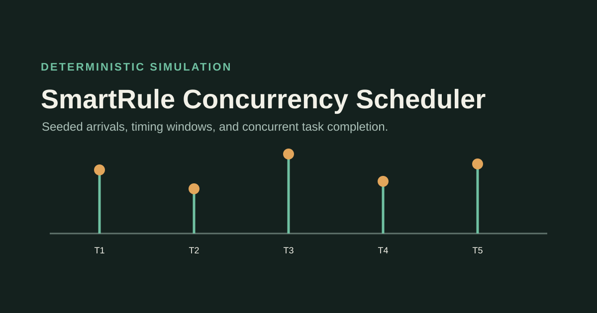
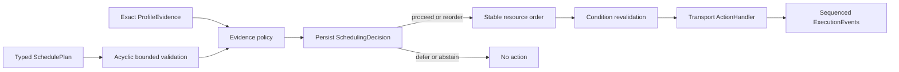

# SmartHome-ThreadSafe-Scheduler

A conflict-aware execution kernel for smart-home service actions. It turns an already-produced `ProfileEvidence` and a typed `SchedulePlan` into a persisted policy decision, then executes only authorized actions under stable read/write resource ordering, lock-time condition revalidation, deadlines, and cooperative cancellation.



## Runtime guarantees covered by tests

- Unknown models, low-confidence, unknown, or ambiguous evidence abstains; anomalous evidence defers.
- A trusted conflict pattern can produce a deterministic reorder, while dependencies remain validated before execution.
- The `DecisionStore` completes before the first action callback. Persistence failure authorizes nothing.
- Resource identifiers are acquired in one stable total order and released in reverse order on success, cancellation, timeout, or failure.
- Read/read leases may overlap; writes serialize. Opposite declaration order cannot create a lock-order cycle inside this model.
- Conditions are evaluated before waiting and revalidated after the locks are held.
- Cancellation while waiting is bounded and partial acquisition is cleaned up.
- Callback errors emit a bounded error code without endpoints, paths, arguments, or stack details.
- Ready tasks are selected before execution; no worker waits for a dependency queued behind it in the same pool.

## Run

Requirements: JDK 8+ and Maven 3.8+.

```bash
mvn test
mvn -q exec:java \
  -Dexec.mainClass=concurrency.demo.SmartRuleSimulationDemo \
  -Dexec.args=examples/rulespec-v0.json
```

The existing deterministic simulation remains available for historical behavior. The supported runtime core is under `concurrency.runtime`; transport integration supplies a real `ActionHandler` that invokes the Logic Engine/TinyRPC provider. The runtime refuses an authorized execution if no handler is present instead of reporting fake success.

`--handler-class` and `--condition-class` are trusted local orchestration inputs for development and controlled deployment. Never populate them from a contract document, renderer, or network request. Production integration should compile an owned, fixed bridge to the selected transport. `--policy-only` persists a policy decision but does not prove action execution or end-to-end integration.

## Structure

- `src/main/java/concurrency/runtime/` — evidence policy, plan validation, resource locks, ports, decisions, events, and execution engine.
- `src/main/java/concurrency/scheduling/` — preserved earlier RuleTree simulation.
- `src/main/java/concurrency/experiment/` — earlier generated and priority experiments.
- `experiments/historical-synchronization/` — provenance-bound critical-section, mutex, condition-variable, Redis/SQL, and monitor research transferred from the profiler repository.

## Guarantee boundary

The tested stable-order resource model prevents lock-order cycles for declared resources. It is not a universal deadlock-freedom or starvation-freedom proof. Cooperative cancellation cleans up scheduler resources but cannot roll back a physical or already-committed external action. Historical SQL `LLSC` experiments are optimistic log validation, not hardware LL/SC or lock-free progress.

## Rights

Source is available for inspection. No new reuse license is granted. GitHub Terms of Service rights for viewing and platform forking still apply; third-party packages and historical material retain their own notices and rights. See `RIGHTS.md`.
