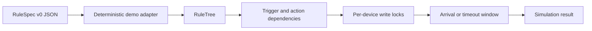

# SmartRule-Concurrency-Scheduler

An experimental Java scheduler for studying concurrent IoT automation rules. It maps trigger and action devices into dependency relationships, serializes competing device writes, and simulates whether a real action arrives within a bounded time window.

> **Research status:** this repository contains a deterministic demonstration path and historical experiments. It is not a production device runtime, message broker, or safety controller.

## Why it exists

Independent automation rules can target the same device or form implicit chains: one rule changes a device that triggers another. This project explores how those rules can be scheduled without overlapping writes and how action-arrival windows affect completion.



The governed path uses the existing `RuleTree`, `RootNode`, `DeviceNode`, and `TaskNode` implementation. Random decisions use an injected seeded `Random`; arrival is configured explicitly as a percentage from `0` to `100`. The former `Math.random() <= 2` comparison made a nominal 2% setting effectively unconditional and has been removed.

## Run the deterministic demo

Requirements: JDK 8+ and Maven 3.8+.

```bash
mvn test
mvn -q exec:java \
  -Dexec.mainClass=concurrency.demo.SmartRuleSimulationDemo \
  -Dexec.args=examples/rulespec-v0.json
```

The demo uses a 100% arrival rate, a fixed seed, and short timing values. It reports completed rule IDs and explicitly reports that conditions are not evaluated. It does not contact devices or external services.

## RuleSpec v0

The portable fixture uses an immutable shape shared with the companion analyzer:

```json
{
  "id": "close-curtain",
  "description": "Close the curtain when rain is detected",
  "triggers": [{"device": "weather", "state": "rain"}],
  "conditions": [],
  "actions": [{"device": "curtain", "state": "closed"}]
}
```

`conditions` are carried for adapter compatibility but are not applied by this scheduler yet.

## Tests

The tests lock down percentage validation, guaranteed arrival and non-arrival paths, seeded repeatability, time-window completion, concurrent task completion, priority ordering, and fixture immutability.

Historical Freemarker, ZooKeeper-style data-tree, and real-user experiment code remains for research traceability. Some historical entry points still rely on old local datasets or generated sources and are not part of the supported demo.

## Limitations

- Busy-wait dependency polling remains part of the research scheduler.
- Rule conditions and device-state verification are not implemented.
- The demo proves deterministic local scheduling behavior, not distributed correctness or performance.
- No benchmark or production reliability claim is made.

## License

No open-source license has been selected yet. Copyright remains with the repository owner; reuse is not granted until a license is added.
